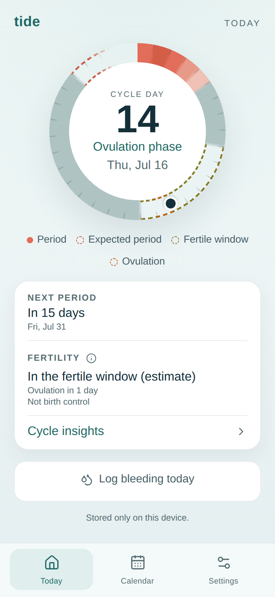
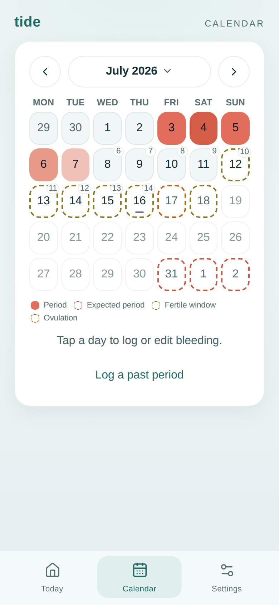

# Tide

[](https://github.com/simonvanlierde/tide/actions/workflows/ts.yml)
[](https://codecov.io/gh/simonvanlierde/tide)
[](https://tide.duinlab.nl)
[](LICENSE)
[](https://tide.duinlab.nl)

Tide is a privacy-first period tracker. It's a small React web app that you can install (a PWA),
and it keeps all your cycle data in your browser: no accounts, no network and no analytics.

| Today | Calendar |
| --- | --- |
| <picture><source media="(prefers-color-scheme: dark)" srcset="docs/screenshots/today-dark.png"></picture> | <picture><source media="(prefers-color-scheme: dark)" srcset="docs/screenshots/calendar-dark.png"></picture> |

## Install

Open **[tide.duinlab.nl](https://tide.duinlab.nl)** and add it to your home screen:

- **iOS (Safari):** Share → *Add to Home Screen*
- **Android (Chrome):** menu (⋮) → *Install app*
- **Desktop (Chrome/Edge):** install icon in the address bar

Once installed, it works offline, and all data stays on your device.

## Features

- Log bleeding days with one tap, or a whole past period at once.
- A cycle dial shows today's cycle day and phase. Drag along it to preview other days.
- Next-period estimates, and if you choose to see them, an approximate fertile window and
  ovulation estimate. Every prediction is a dashed outline, so it never looks like a logged day.
  [How predictions work](docs/predictions.md), and Today shows the sums behind your own date.
- Save your next expected periods as a calendar file for any calendar app.
- Insights, and a calendar with cycle day numbers.
- Back up to a JSON file, restore it on any device, or delete everything in one go.
- Import a Clue export (`measurements.json` from the export zip, or an older `.cluedata` backup)
  or a Flo export from Settings → Data → Import. It adds to the days you already logged; a Tide
  backup replaces your data instead.

The estimates are for information only. They are not a form of birth control.

## Development

You need [just](https://just.systems) and [pnpm](https://pnpm.io).

```bash
pnpm install
pnpm exec playwright install chromium   # once per machine, for the e2e tests
pnpm exec prek install                  # git hooks
```

`pnpm dev` starts the app. `just check` runs what CI runs, and `just ts-e2e` the browser tests.

See [CONTRIBUTING.md](CONTRIBUTING.md) for the checks, architecture and deploy setup, and
[docs/](docs/) for the [prediction backtest](docs/backtest.md) and the
[decision to keep data on the device](docs/adr/0001-local-first-no-backend.md).
[Open an issue](https://github.com/simonvanlierde/tide/issues/new/choose) for bugs and ideas.

## License

[MIT](LICENSE) © Simon van Lierde
