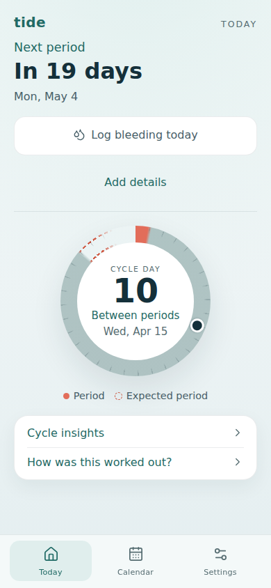
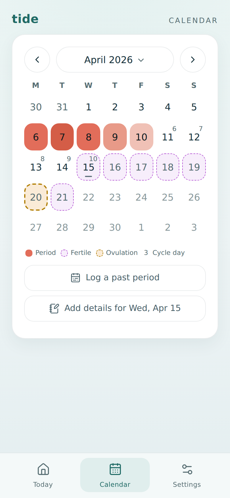

# Tide

[](https://github.com/simonvanlierde/tide/actions/workflows/ts.yml)
[](https://codecov.io/gh/simonvanlierde/tide)
[](https://tide.duinlab.nl)
[](LICENSE)
[](https://tide.duinlab.nl)
[](https://scorecard.dev/viewer/?uri=github.com/simonvanlierde/tide)

Tide is a privacy-first period tracker. It's a small React web app that you can install (a PWA),
and it keeps all your cycle data in your browser, without accounts or uploading your history.

| Today | Calendar |
| --- | --- |
| <picture><source media="(prefers-color-scheme: dark)" srcset="docs/screenshots/today-dark.png"></picture> | <picture><source media="(prefers-color-scheme: dark)" srcset="docs/screenshots/calendar-dark.png"></picture> |

## Install

Open **[tide.duinlab.nl](https://tide.duinlab.nl)** and add it to your home screen:

- **iOS (Safari):** Share → *Add to Home Screen*
- **Android (Chrome):** menu (⋮) → *Install app*
- **Desktop (Chrome/Edge):** install icon in the address bar

Once installed, it works offline, and Tide does not upload what you log.
Clearing this site's browser data removes your history. Keep a backup from Settings → Data → Export
so you can restore it later. Installing Tide does not create a separate backup or sync devices.

## Features

- Log bleeding days with one tap, or a whole past period at once.
- Add optional symptoms, a mood and a short note for today or a past day, whether or not
  you logged bleeding. These details stay in your diary and do not affect predictions.
- A cycle dial shows today's cycle day and phase. Drag along it to preview other days.
- Next-period estimates, and if you choose to see them, an approximate fertile window and
  ovulation estimate. Every prediction is an outline, so it never looks like a logged day.
  [How predictions work](docs/predictions.md), and Today shows the sums behind your own date.
- Save your next expected periods as a calendar file for any calendar app.
- Cycle insights show the latest 12 completed cycle lengths as a chart and a table.
  Mark a cycle incomplete to leave it out of cycle-length estimates while keeping its logged days.
- A calendar with cycle day numbers.
- Back up to a JSON file, restore it on any device, or delete everything in one go.
  Backups include your daily details as well as your bleeding history and settings.
  A local reminder appears after 60 days; you can snooze it for a week.
- Import a Clue export (`measurements.json` from the export zip, or an older `.cluedata` backup)
  or a Flo export from Settings → Data → Import. It adds to the days you already logged; a Tide
  backup replaces your data instead. Clue and Flo imports bring in bleeding days only.

The estimates are for information only. They are not a form of birth control.

The [JSON backup contract](docs/backups.md) explains the saved fields, restore rules and a tested example.

### Daily details

Choose **Details**, next to the log button on Today, to record cramps, a headache, bloating,
breast tenderness or fatigue. You can choose **No symptoms** to record that you had none;
leaving symptoms blank means you did not record them. Mood and a note of up to 1,000
characters are optional too. Each choice saves as you make it; **Clear details** offers
Undo. On Calendar, use the dated links under **Daily details** to revisit entries for that
month, or choose a date in the editor.

## Development

You need Node.js 26 or newer, [just](https://just.systems) and [pnpm](https://pnpm.io).
The `packageManager` field in `package.json` names the pnpm version used by this project.

```sh
pnpm install
pnpm exec playwright install chromium   # once per machine, for the e2e tests
pnpm exec prek install                  # git hooks
```

[Predictor performance](docs/performance.md) describes the synthetic benchmark and its limits.

`pnpm dev` starts the app. `just check` runs what CI runs, and `just ts-e2e` the browser tests.

See [CONTRIBUTING.md](CONTRIBUTING.md) for the checks and architecture,
[docs/](docs/) for the [architecture](docs/architecture.md), the [prediction backtest](docs/backtest.md) and the
[decision to keep data on the device](docs/adr/0001-local-first-no-backend.md).
[Open an issue](https://github.com/simonvanlierde/tide/issues/new/choose) for bugs and ideas.

## Social card

`public/og.png` is the 1200x630 card shown when the link is shared. Its source is
[`docs/og-card.html`](docs/og-card.html). The ring in it, `docs/og-ring.png`, is the app's own cycle dial,
captured with sample cycles. After a change to the card or the dial, render both again (needs Playwright Chromium):

```sh
pnpm og-card
```

## Deploy

The app runs on a Cloudflare Worker that serves the build as static assets, configured in
[`wrangler.jsonc`](wrangler.jsonc). CI deploys it: every push to `main` deploys the build the
checks ran on. [`public/_headers`](public/_headers) sets the response headers, including the
Content-Security-Policy that the e2e tests run under. Until the custom domain moves to the Worker,
<https://tide.duinlab.nl> is still served by the Cloudflare Pages project that builds `main`.

One-time setup, for production and previews alike:

1. Run `just repo-settings` to create the `production` and `preview` environments, with
   `production` limited to `main`.
2. Add the secrets `CLOUDFLARE_API_TOKEN` (a custom token with Account > Workers Scripts: Edit)
   and `CLOUDFLARE_ACCOUNT_ID` to both environments, not to the repository.
3. Give the Cloudflare account a workers.dev subdomain, if it has none yet.

Without the token, the deploy jobs skip with a notice. To roll back, revert the commit on `main`,
or re-run an earlier run's production job while its build artifact exists (7 days).

### Pull request previews

Each pull request that is open, not a draft and not from a bot gets its own Cloudflare Worker,
`tide-pr-<number>`, deployed from the same `wrangler.jsonc` under that name and deleted again when
the pull request closes or turns draft
([how it works](https://github.com/simonvanlierde/project-templates/blob/main/docs/usage.md#pull-request-previews)).
Previews are public: anyone with the address can open one.

## License

[MIT](LICENSE) © Simon van Lierde
