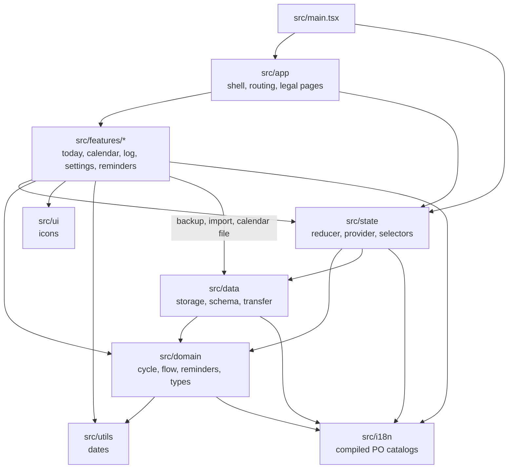

# Architecture

Tide is a static React app with no backend. Vite builds it to `dist/`, and everything a user logs
stays in the browser's `localStorage`. [ADR 0001](adr/0001-local-first-no-backend.md) records why.

## Layers

I keep the cycle logic pure and away from React and the browser, so it can be tested as plain
functions. Dependencies point inward:

- `src/domain`: pure cycle and reminder logic, with no React, storage or browser APIs.
- `src/data`: the only code that reads and writes `localStorage`, plus the backup, import and
  calendar files.
- `src/state`: the reducer and selectors in `core.ts`, and the React provider that holds the state.
- `src/app`: the app shell and routing by pathname (`/`, `/calendar`, `/settings` and the legal pages).
- `src/features`: one folder per screen or flow.
- `src/i18n`: Lingui PO catalogs, one per locale, compiled into the bundle.
- `src/ui`, `src/styles` and `src/utils`: shared icons, styles and date helpers.

## Translations

Lingui 6 renders explicit message IDs from five PO catalogs in `src/i18n/locales`.
`src/state/provider.tsx` supplies the React `I18nProvider` and the bound `useT()`
translator. Each locale has its own Lingui instance, so rendering another language cannot
change the active screen. Plural messages use ICU `one` and `other` branches.
Dates still use `Intl` with the resolved language preference.

The forecast explainer has a second catalog in `src/features/today/locales`, compiled
into its lazy chunk. The service worker precaches that chunk along with the app.
All five languages work offline; choosing a language makes no catalog request.
`lingui compile --strict` runs before development, builds, type checks and tests.
Generated `.mjs` files are ignored by Git. Edit catalogs manually; the
[translation workflow](../README.md#translations) describes the commands.
[ADR 0002](adr/0002-lingui-catalogs.md) records the choice.

## Data flow

1. On start, `AppStateProvider` (`src/state/provider.tsx`) loads the saved state through
   `loadStoredState` in `src/data/storage.ts`. `normalizeAppState` in `src/data/schema.ts` checks
   every field and fills defaults. A blob it had to change is kept under a backup key first.
2. Screens dispatch actions to `appStateReducer` in `src/state/core.ts`. Each change is saved back
   to `localStorage`. A state written by a newer build is shown read-only and never saved over.
3. `selectForecast` passes the logged days to `forecast` in `src/domain/cycle.ts`, which works out
   the next period and, if the user turned it on, the fertile window.
   [How predictions work](predictions.md) has the rules and numbers.
4. Settings → Data uses `src/data/transfer.ts` to save a JSON backup and to read one back, and
   `src/data/otherApps.ts` to read Clue and Flo exports. A Tide backup replaces the state, and
   includes daily symptoms, mood and notes. Bleeding days from another app are merged under
   the ones already logged; these imports leave daily details unchanged.
5. A `storage` event from another tab or the installed app replaces the state with that window's
   saved copy. Simultaneous edits are not merged; the last save wins.

Daily details are separate from bleeding logs. The forecast uses bleeding history only;
symptoms, mood and notes do not change estimates. An empty symptom list means the user
recorded no symptoms; a null value means symptoms were not recorded.

## Offline and hosting

`vite-plugin-pwa` (in `vite.config.ts`) writes the web app manifest and a service worker that
precaches the build, so the app works offline and updates itself on the next visit.
The legal pages in `docs/` are Markdown, turned into HTML at build time by the `markdown` plugin
in the same file.

Cloudflare hosts `dist/` with the headers in `public/_headers`. The README
[Deploy section](../README.md#deploy) describes the Worker deployment and pending custom-domain migration.
The Content-Security-Policy limits app requests to this origin. Cloudflare can also instruct the browser
to send network error reports, as the [privacy statement](privacy.md#what-our-host-sees) explains.

## Tests

Vitest tests in `tests/` follow the same layers, one folder each, with component tests for the
screens in `tests/ui`. On top sits a thin layer of Playwright tests in `tests/e2e`
against the production build: routing, data that survives a reload, accessibility, the CSP and a
smoke test of the PWA.
