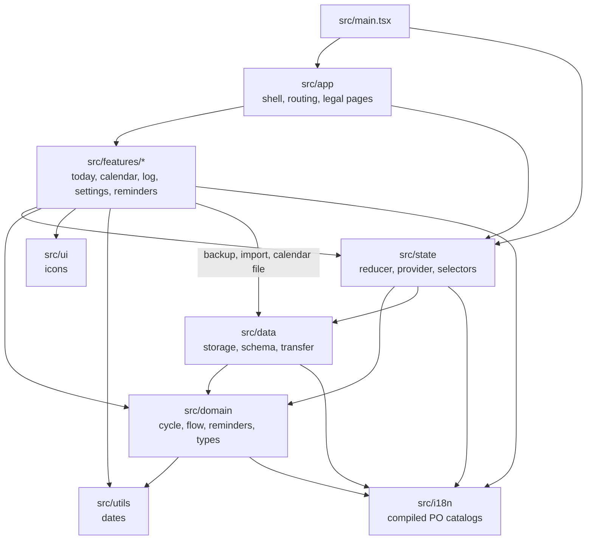

# Architecture

Tide is a static React app with no backend. Vite builds it to `dist/`, and everything a user logs
stays in the browser's `localStorage`. [ADR 0001](adr/0001-local-first-no-backend.md) records why.

## Layers

I keep the cycle logic pure and away from React and the browser, so it can be tested as plain
functions. Dependencies point inward:

- `src/domain`: pure cycle and reminder logic, with no React, storage or browser APIs.
- `src/data`: the only code that reads and writes `localStorage`, plus the backup, import and
  calendar files.
- `src/state`: the reducer and selectors in `core.ts`, and the React provider that holds the state.
- `src/app`: the app shell and routing by pathname (`/`, `/calendar`, `/settings` and the legal pages).
- `src/features`: one folder per screen or flow.
- `src/i18n`: Lingui PO catalogs, one per locale, compiled into the bundle.
- `src/ui`, `src/styles` and `src/utils`: shared icons, styles and date helpers.

## Translations

`src/state/provider.tsx` binds `useT()` to the language saved in the app state. Each locale has
its own Lingui instance, so rendering text in another language can't switch the active screen.
Dates use `Intl` with the resolved language. The forecast explainer's catalogs compile into its
lazy chunk, which the service worker precaches with the app, so every language works offline.
[Development](development.md#translations) has the editing rules and commands, and
[ADR 0002](adr/0002-lingui-catalogs.md) records the choice.

## Data flow

1. On start, `AppStateProvider` (`src/state/provider.tsx`) loads the saved state through
   `loadStoredState` in `src/data/storage.ts`. `normalizeAppState` in `src/data/schema.ts` checks
   every field and fills defaults. A blob it had to change is kept under a backup key first.
   If that backup cannot be saved, the recovery screen offers the original data as a download
   and prevents a normalized save from overwriting it.
   The current key is `tide.period-tracker.state.v1`. When absent, Tide first copies the raw
   legacy value from `tide.period-tracker.state`; a failed copy opens recovery without changing the source.
   Later writes to the legacy key are ignored. This keeps older tabs from stripping newer fields
   or repeatedly rewriting state between versions. The legacy value and its backup remain until
   **Delete all data**, which clears both generations and leaves current defaults to prevent reimport.
2. Screens dispatch actions to `appStateReducer` in `src/state/core.ts`. Each change is saved back
   to `localStorage`. A state written by a newer build is shown read-only and never saved over.
3. `selectForecast` passes the logged days to `forecast` in `src/domain/cycle.ts`, which works out
   the next period and, if the user turned it on, the fertile window.
   [How predictions work](predictions.md) has the rules and numbers.
4. Settings → Data uses `src/data/transfer.ts` to save a JSON backup and to read one back, and
   `src/data/otherApps.ts` to read Clue and Flo exports. A Tide backup replaces the state, and
   includes daily symptoms, mood and notes. Bleeding days from another app are merged under
   the ones already logged; these imports leave daily details unchanged.
5. A `storage` event from another tab or the installed app replaces the state with that window's
   saved copy. Simultaneous edits are not merged; the last save wins.

Daily details are separate from bleeding logs, and the forecast reads bleeding history only.
A day without symptoms stores `null`; there is no separate "no symptoms" record.

`DayEditor` is the dated editor that Today and Calendar share. It combines `FlowGauge` and
`DiaryFields`, and bleeding and diary changes stay independent. Calendar owns the selected date,
and opening a day never logs bleeding. Every change saves as it happens. On portrait phones the
editor floats above the measured tab bar and keeps itself inside the visual viewport; larger
screens and short landscape windows show it inline.

A range log keeps its confirmation in memory only. It expires after ten seconds, and hover or
focus inside it pauses the timer.

## First-use guidance

Schema 5 adds two settings, `onboardingDismissed` and `calendarHelpDismissed`. A fresh install
starts both as false. An existing saved state without them loads with both set to true, so an
upgrade shows no introduction. The bump also makes an older tab open the newer state read-only.

Today's introduction replaces the empty dial until the user skips it, or logs a first bleeding day,
daily detail or import. Its fertility question changes only `showFertility`. The Calendar hint
closes once a bleeding day or range is logged there. Undo brings neither back.

Both flags stay on the device: backups omit them, and Delete all data resets them.

## Offline and hosting

`vite-plugin-pwa` (in `vite.config.ts`) writes the web app manifest and a service worker that
precaches the build, so the app works offline and updates itself on the next visit.
The legal pages in `docs/` are Markdown, turned into HTML at build time by the `markdown` plugin
in the same file.

Cloudflare hosts `dist/` with the headers in `public/_headers`.
[Deploy](development.md#deploy) describes the Worker and the custom-domain move.
The Content-Security-Policy limits app requests to this origin. Cloudflare can also instruct the browser
to send network error reports, as the [privacy statement](privacy.md#what-our-host-sees) explains.

## Tests

Vitest tests in `tests/` follow the same layers, one folder each, with component tests for the
screens in `tests/ui`. On top sits a thin layer of Playwright tests in `tests/e2e`
against the production build: routing, data that survives a reload, accessibility, the CSP and a
smoke test of the PWA.
