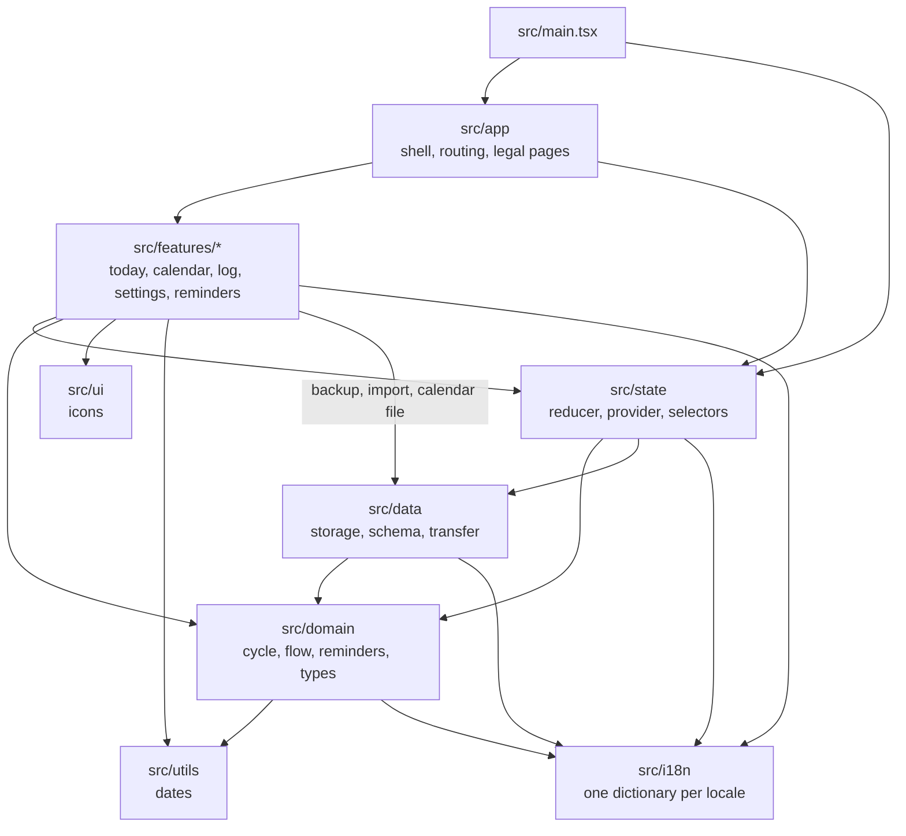

# Architecture

Tide is a static React app with no backend. Vite builds it to `dist/`, and everything a user logs
stays in the browser's `localStorage`. [ADR 0001](adr/0001-local-first-no-backend.md) records why.

## Layers

I keep the cycle logic pure and away from React and the browser, so it can be tested as plain
functions. Dependencies point inward:

- `src/domain`: pure cycle and reminder logic, with no React, storage or browser APIs.
- `src/data`: the only code that reads and writes `localStorage`, plus the backup, import and
  calendar files.
- `src/state`: the reducer and selectors in `core.ts`, and the React provider that holds the state.
- `src/app`: the app shell and routing by pathname (`/`, `/calendar`, `/settings` and the legal pages).
- `src/features`: one folder per screen or flow.
- `src/i18n`: typed message dictionaries, one per locale.
- `src/ui`, `src/styles` and `src/utils`: shared icons, styles and date helpers.

## Data flow

1. On start, `AppStateProvider` (`src/state/provider.tsx`) loads the saved state through
   `loadStoredState` in `src/data/storage.ts`. `normalizeAppState` in `src/data/schema.ts` checks
   every field and fills defaults. A blob it had to change is kept under a backup key first.
2. Screens dispatch actions to `appStateReducer` in `src/state/core.ts`. Each change is saved back
   to `localStorage`. A state written by a newer build is shown read-only and never saved over.
3. `selectForecast` passes the logged days to `forecast` in `src/domain/cycle.ts`, which works out
   the next period and, if the user turned it on, the fertile window.
   [How predictions work](predictions.md) has the rules and numbers.
4. Settings → Data uses `src/data/transfer.ts` to save a JSON backup and to read one back, and
   `src/data/otherApps.ts` to read Clue and Flo exports. A Tide backup replaces the state, and
   days from another app are merged under the ones already logged.
5. A `storage` event from another tab or the installed app replaces the state, so two windows
   don't overwrite each other.

## Offline and hosting

`vite-plugin-pwa` (in `vite.config.ts`) writes the web app manifest and a service worker that
precaches the build, so the app works offline and updates itself on the next visit.
The legal pages in `docs/` are Markdown, turned into HTML at build time by the `markdown` plugin
in the same file.

Cloudflare Pages serves `dist/` with the headers in `public/_headers`. Their Content-Security-Policy
allows this origin only, so the app cannot load or send anything elsewhere.

## Tests

Vitest tests in `tests/` follow the same layers, one folder each, with component tests for the
screens in `tests/ui`. On top sits a thin layer of Playwright tests in `tests/e2e`
against the production build: routing, data that survives a reload, accessibility, the CSP and a
smoke test of the PWA.
